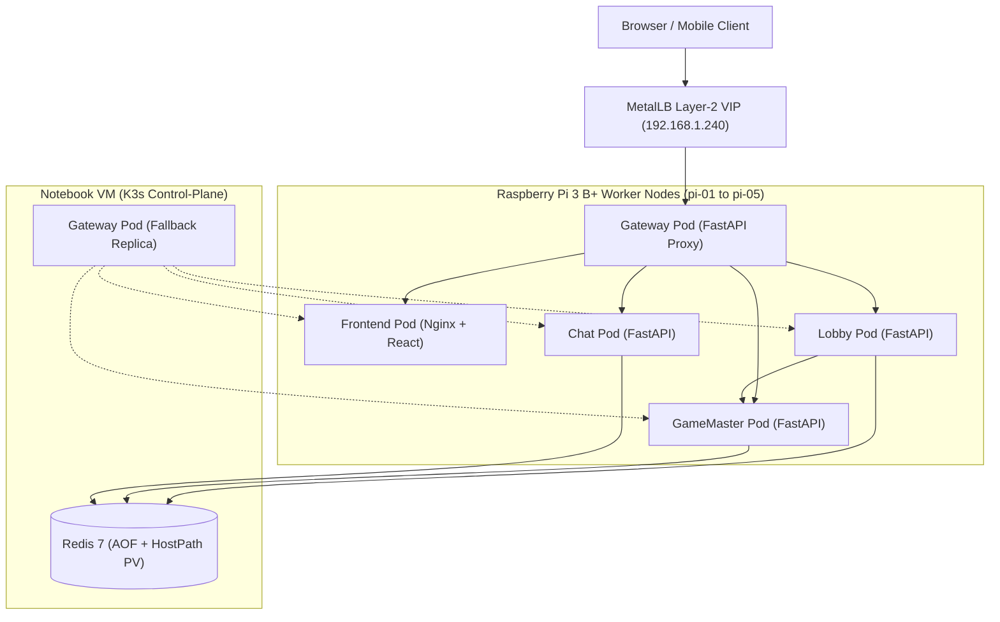

# Architecture & Infrastructure Specification

> **Target Audience:** Infrastructure Lead, DevOps / Platform Engineers  
> **Related Files:** [README.md](../README.md), [03-team-workflow.md](03-team-workflow.md), [api-contract.md](../contracts/api-contract.md)

---

## 1. Cluster & Network Architecture

### 1.1 Physical & Virtual Topology
The system runs on a hybrid Bare-Metal Kubernetes cluster managed by **K3s**:
- **Control-Plane (Master Node):** Runs inside an **Ubuntu Linux 64-bit Virtual Machine** on the student's notebook. The VM requires at least 2 vCPUs and 2 GB RAM. It connects to the cluster via a **Bridged Network Adapter**, placing it in the same L2 subnet (`192.168.1.0/24`) as the Raspberry Pis.
- **Worker Nodes (5x Pi Workers):** **Raspberry Pi 3 B+** (ARM Cortex-A53 64-bit, 1 GB LPDDR2 SDRAM) running Raspberry Pi OS Lite 64-bit.
- **Physical Network:** All 5 Pis and the Notebook are connected directly via Cat5e Ethernet patch cables to an on-site **TP-Link TL-WR841N** 100Mbps Ethernet Switch / Router.

### 1.2 SDN & Network Layer (CNI & Load Balancing)
- **Container Network Interface (CNI):** **Flannel** (configured in VXLAN mode, built into K3s). It establishes a Software-Defined Overlay Network across the notebook VM and 5 Pis, enabling every Pod to communicate directly via a flat IP space (`10.42.0.0/16`) regardless of host machine.
- **Bare-Metal Load Balancer:** **MetalLB** operating in **Layer 2 Mode (ARP)**. MetalLB responds to ARP requests on the physical LAN for an assigned Virtual IP (VIP) (e.g., `192.168.1.240`). When traffic hits the VIP, MetalLB directs packets to the node currently hosting the `gateway` Pod.



---

## 2. Container Images & Microservice Responsibilities

The system consists of **5 custom application container images** and **1 infrastructure image**:

| Image Name | Tech Stack | Failure Isolation & Architectural Responsibility | State Handling |
|---|---|---|---|
| **`gateway`** | FastAPI + `httpx` (async) | Single entry-point for all incoming traffic. Routes `/` to Frontend and `/api/...` to backend handlers. Generates `request_id`, tracks execution traces across nodes, standardizes error envelopes. | **Stateless**: Transient in-memory request tracking only. |
| **`frontend`** | React + Vite + Nginx Alpine | Serves pre-built static single-page application (SPA). Reverse-proxied via Gateway to maintain the strict requirement that even page loads touch ≥ 2 containers. | **Stateless**: Browser local memory only. |
| **`lobby`** | FastAPI + `redis.asyncio` | Handles pre-game room lifecycle (Create, Join, List Players). Issues cryptographically random Player Session Tokens. Hands off control to GameMaster upon game start. | **Stateless**: Ephemeral execution; all room records reside in Redis. |
| **`gamemaster`** | FastAPI + `redis.asyncio` | Core authoritative game engine: role assignment, phase state transitions (NIGHT/DAY), timeout calculations via Redis `TIME`, vote tallying, role resolution, and win condition checks. | **Stateless**: Pure business logic engine; queries and writes to Redis atomically. |
| **`chat`** | FastAPI + `redis.asyncio` | Manages role-based chat channels (`PUBLIC`, `WOLF`, `DEAD`). Validates sender eligibility against current game state and persists message streams. | **Stateless**: Message histories are retrieved from and appended to Redis. |
| **`redis`** | Redis 7.2 Alpine (Official) | Central authoritative state store: internal room states, chat message lists, atomic version counters, and session token hashes. | **Stateful**: Pinned strictly to Notebook Control-Plane VM with persistent volume. |

---

## 3. Kubernetes Placement & Scheduling Strategy

To satisfy the rubric rule that **requests must cross nodes**, the cluster uses a carefully orchestrated Pod Anti-Affinity configuration.

### 3.1 Hard Pod Anti-Affinity: Gateway vs Handlers
The entry-point (`gateway`) must never execute on the same node as the backend container servicing the request.

```yaml
# Inside gateway deployment manifest:
spec:
  affinity:
    podAntiAffinity:
      requiredDuringSchedulingIgnoredDuringExecution:
      - labelSelector:
          matchExpressions:
          - key: component
            operator: In
            values: ["handler"]
        topologyKey: "kubernetes.io/hostname"
```

All backend services (`frontend`, `lobby`, `gamemaster`, `chat`) are labeled with `component=handler`. This guarantees that if `gateway` lands on `pi-01`, no handler pod will ever be scheduled on `pi-01`.

### 3.2 Gateway Fallback to Control-Plane
In normal conditions, `gateway` prefers scheduling on a Pi worker. However, during a Pi failure where remaining Pis are saturated with handler pods, `gateway` has a soft preference allowing it to schedule on the Control-Plane node:
```yaml
nodeSelectorTerms:
- matchExpressions:
  - key: node-role
    operator: In
    values: ["pi", "control-plane"]
```

### 3.3 Pinning Redis to the Control-Plane Node
To ensure game state survives any Pi worker being disconnected, Redis is explicitly pinned to the Notebook VM:
```yaml
spec:
  nodeSelector:
    node-role: control-plane
  tolerations:
  - key: "node-role.kubernetes.io/control-plane"
    operator: "Exists"
    effect: "NoSchedule"
  volumes:
  - name: redis-storage
    hostPath:
      path: /var/lib/werewolf-redis
      type: DirectoryOrCreate
```

---

## 4. Resource Allocation & Limits (Raspberry Pi 3 B+)

Each Raspberry Pi 3 B+ has only **1 GB of RAM** shared between the Linux kernel, systemd, K3s agent, Flannel, container runtime (`containerd`), and application pods. Aggressive memory ceilings are mandatory to prevent kernel Out-Of-Memory (OOM) panics.

### 4.1 Resource Budgets

| Container | CPU Request | CPU Limit | Memory Request | Memory Limit | Rationale |
|---|---|---|---|---|---|
| `gateway` | 50m | 200m | 64 MiB | 160 MiB | Handles async reverse-proxy buffering. |
| `frontend` | 20m | 100m | 16 MiB | 64 MiB | Lightweight Nginx static asset server. |
| `lobby` | 50m | 200m | 64 MiB | 160 MiB | FastAPI handling JSON serialization. |
| `gamemaster` | 100m | 300m | 64 MiB | 160 MiB | Rule resolution and JSON state validation. |
| `chat` | 50m | 200m | 64 MiB | 160 MiB | Message validation and Redis list appending. |
| `redis` | 100m | 500m | 128 MiB | 512 MiB | Runs on Notebook VM (abundant RAM). |

### 4.2 Multi-Arch ARM64 Compilation
All images must be compiled specifically for `linux/arm64` using Docker Buildx:
```bash
docker buildx build --platform linux/arm64 -t werewolf/gateway:v1.0 ./services/gateway --load
```

---

## 5. Fault-Tolerance Plan & Failure Recovery

### 5.1 Failure Detection & Pod Eviction Parameters
By default, Kubernetes takes up to 300 seconds to evict pods from an unreachable node. For the on-site demo, these timers are tuned down:
- `node-monitor-period`: `4s`
- `node-monitor-grace-period`: `16s`
- Pod `tolerationSeconds` for `node.kubernetes.io/unreachable` and `not-ready`:
  ```yaml
  tolerations:
  - key: "node.kubernetes.io/unreachable"
    operator: "Exists"
    effect: "NoExecute"
    tolerationSeconds: 10
  - key: "node.kubernetes.io/not-ready"
    operator: "Exists"
    effect: "NoExecute"
    tolerationSeconds: 10
  ```

### 5.2 Fault-Tolerance Test Matrix

| Failure Scenario | Injected Action | Expected System Behavior | Verification |
|---|---|---|---|
| **App Pod Crash** | `kubectl delete pod -l app=gamemaster` | Deployment controller immediately spawns a replacement pod on an eligible Pi. | Pod enters `Running` in < 5s; Game state remains in Redis. |
| **Pi Worker Offline (Handler)** | Unplug LAN from Pi running `lobby` | Node marked `NotReady`. Pod evicted after toleration timeout. K3s schedules replacement `lobby` pod onto an active Pi. | `kubectl get pods -w` shows replacement; `POST /join` succeeds once Ready. |
| **Pi Worker Offline (Gateway)** | Unplug LAN from Pi running `gateway` | `gateway` pod evicted. Replacement scheduled onto another Pi (or fallback to Control-Plane if all Pis hold handlers). MetalLB re-announces ARP VIP. | Web browser reconnects automatically via polling; URL unchanged. |
| **Worker Rejoin** | Reconnect LAN cable to recovered Pi | Node rejoins cluster and transitions to `Ready`. Existing pods remain stable (no unnecessary flapping). | `kubectl get nodes` returns to 5 Ready workers. |

---

## 6. Architecture Decisions Log (ADL)

| Decision | Context & Trade-off | Rationale |
|---|---|---|
| **ADL-01: Pin Redis to Control-Plane** | Avoids Redis Master-Replica Sentinel on Pi workers. | Rubric specifies randomly disconnecting **Pi nodes**, not the notebook. Placing Redis on Master guarantees 100% data preservation without multi-master consensus overhead on 1GB Pis. |
| **ADL-02: REST Polling over WebSockets** | 2-second HTTP polling replaces persistent WebSocket connections. | WebSockets suffer from socket deadlocks and complex client-side reconnection during node evictions. REST requests fail fast and auto-recover on the very next poll cycle. |
| **ADL-03: Single Replica per Service in MVP** | 1 replica per microservice with K8s self-healing replacements. | Rubric explicitly states: *"app can fail until the point where the replacements are running"*. This drastically conserves RAM on the Pi nodes. |
| **ADL-04: Hard Pod Anti-Affinity** | `gateway` prohibited from sharing node with `handler`. | Conclusively proves the SDN requirement: client requests cannot be serviced locally inside a single Pi. |
| **ADL-05: Server-Authoritative Timer** | Timers stored as Unix Epoch in Redis (`phase_end_time`) using Redis `TIME`. | Prevents clock drift among the 5 Pis and prevents client browsers from tampering with phase expirations. |
