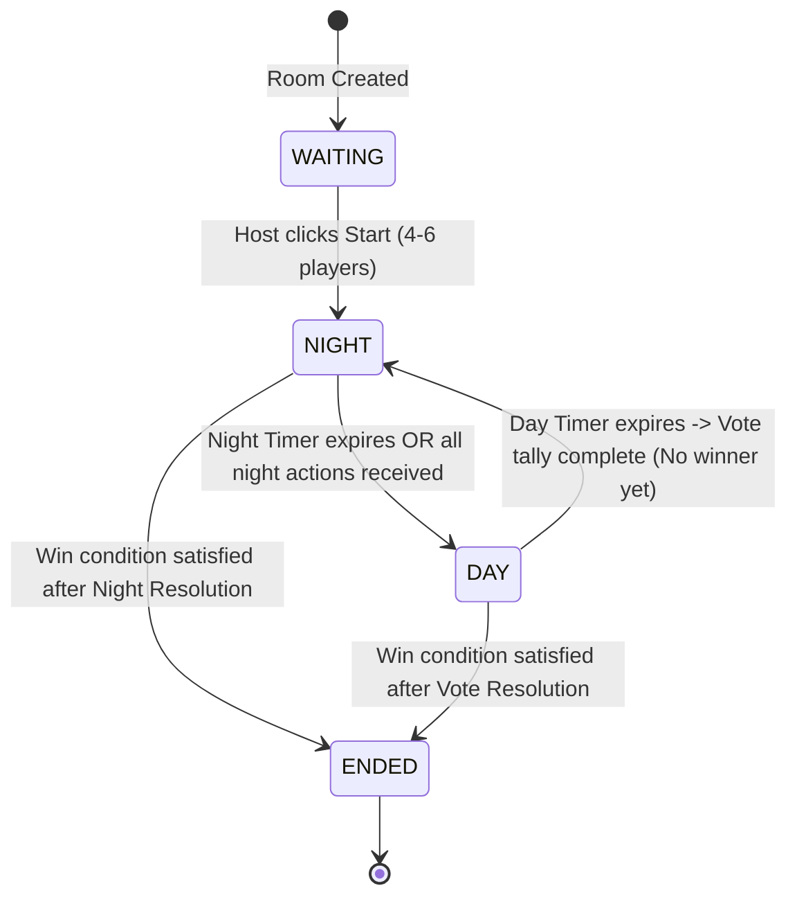

# Werewolf Game Rules & Frontend UX Specification

> **Target Audience:** GameMaster Developers, Frontend Engineers, UI/UX Designers  
> **Related Files:** [api-contract.md](../contracts/api-contract.md), [01-architecture-infra.md](01-architecture-infra.md)

---

## 1. Player Counts & Role Distribution

The MVP supports **4 to 6 players** per game session. The game cannot start with fewer than 4 players, and will reject more than 6 players.

### 1.1 Role Distribution Matrix
When the Host triggers game start, the `gamemaster` randomly assigns roles according to the active player count:

| Total Players | Werewolf (`WEREWOLF`) | Doctor (`DOCTOR`) | Seer (`SEER`) | Villager (`VILLAGER`) |
|:---:|:---:|:---:|:---:|:---:|
| **4** | 1 | 1 | 1 | 1 |
| **5** (Demo Standard) | 1 | 1 | 1 | 2 |
| **6** | 2 | 1 | 1 | 2 |

### 1.2 Room Admission Rules
- **Minimum Players (1–3):** Players can join and wait in the Lobby. The **Start Game** button on the Host's screen remains **Disabled**. Any direct API call to start the game returns an error.
- **Valid Players (4–6):** The **Start Game** button becomes **Active** for the Host only.
- **Maximum Players (> 6):** Any 7th player attempting to join is rejected with HTTP `409 ROOM_FULL`.
- **Game in Progress:** Once started, the room status shifts from `WAITING` to `NIGHT`. Further joins are rejected with HTTP `409 GAME_ALREADY_STARTED`.

---

## 2. Phase State Machine

The game operates as a server-authoritative deterministic finite state machine (FSM):

### 2.1 Server-Authoritative Durations
- `NIGHT_DURATION_SECONDS = 45`
- `DAY_DURATION_SECONDS = 60`
- Timers are calculated strictly using **Redis `TIME`** at the moment of phase transition:
  $$\text{phase\_end\_time} = \text{Redis TIME} + \text{DURATION\_SECONDS}$$
- The client browser displays a countdown timer based on `phase_end_time` but **never decides phase transitions**. When a client polls `GET /api/game/rooms/{room_id}/state`, the GameMaster executes `advance_if_expired()` before responding.

---

## 3. Night Phase Mechanics

During the Night, only living players with an active role perform actions.

### 3.1 Role Actions
1. **Werewolf (`WEREWOLF`):**
   - Must select one living target player who is **not themselves**.
   - If there are 2 werewolves (6-player game), each submits their target independently.
   - **Tally:** Target receiving the strict majority of werewolf votes becomes the primary victim. In the event of a tie, no target is attacked that night.
   - Submissions are idempotent (submitting the same target again succeeds; changing targets mid-phase is disallowed in MVP).
2. **Doctor (`DOCTOR`):**
   - Selects one living player to protect from werewolf attacks.
   - The Doctor **is permitted** to protect themselves.
   - If the Doctor's target matches the Werewolf victim, the attack is negated and the victim survives.
3. **Seer (`SEER`):**
   - Selects one living player (excluding themselves) to reveal alignment.
   - Server registers the target and reveals `WEREWOLF` or `GOOD` strictly to that Seer's private view (`private_info.seer_result`).
4. **Villagers (`VILLAGER`):**
   - No actions during the night. UI displays an atmospheric "Sleeping" waiting screen.

### 3.2 Night Resolution Pipeline
Night concludes immediately when **all living action-holders submit their actions** OR **the 45-second timer expires**.
1. Missing actions at timeout are treated as **Abstain / No Action**.
2. Werewolf targets are aggregated.
3. If victim is identified and Doctor did not protect them, victim dies (`alive = false`).
4. If Doctor protected the victim or no target was chosen, zero casualties occur.
5. Win conditions are evaluated immediately. If no winner, transition to `DAY`.

---

## 4. Day Phase & Voting Mechanics

The Day Phase lasts **60 seconds**, combining public discussion and execution voting into a unified, reliable interaction window.

### 4.1 Discussion & Voting Window
- **Public Chat:** All living players can send messages to the `PUBLIC` chat channel to deliberate. Dead players may read public chat history but cannot send messages.
- **Voting:** Every living player submits a single ballot selecting a living candidate's `player_id` or selecting `SKIP`.
- Submitting the same ballot again is idempotent. Submitting a conflicting ballot returns HTTP `409 ACTION_ALREADY_SUBMITTED`.

### 4.2 Deterministic Vote Resolution Algorithm
When the 60-second timer expires:
1. Valid ballots from living players are tallied.
2. If `Total Ballots == 0`, no execution occurs.
3. If `SKIP_votes >= Highest_Candidate_votes`, no execution occurs.
4. If there is a tie between top candidates, no execution occurs (no lynching on split decisions).
5. If a single candidate strictly holds the highest vote count and exceeds `SKIP`, that player is executed (`alive = false`).
6. Casualties and execution results are announced.
7. Win conditions are evaluated immediately. If no winner, transition to `NIGHT`.

---

## 5. Win Conditions

Win conditions are checked atomically at the end of both Night Resolution and Day Vote Resolution:

$$\text{alive\_wolves} = \sum (\text{role} == \text{WEREWOLF} \land \text{alive})$$
$$\text{alive\_good} = \sum (\text{role} \in \{\text{DOCTOR}, \text{SEER}, \text{VILLAGER}\} \land \text{alive})$$

- **Villager Victory:**
  $$\text{alive\_wolves} == 0 \implies \text{winner} = \text{VILLAGER}, \text{phase} = \text{ENDED}$$
- **Werewolf Victory:**
  $$\text{alive\_wolves} \ge \text{alive\_good} \implies \text{winner} = \text{WEREWOLF}, \text{phase} = \text{ENDED}$$
- **Game Continues:** If neither condition is met, advance to the subsequent phase.
- **End State Reveal:** Once `phase == ENDED`, all player roles are revealed to all participants on the game-over screen.

---

## 6. Frontend UX & Polling Specification

### 6.1 Screen Flow
1. **Landing / Join Screen:**
   - Tabs for "Create Room" (name input) and "Join Room" (room code + name input).
   - Validation: Trim whitespace, enforce name length 2–20 characters.
2. **Lobby Screen:**
   - Prominently displays the 4-character Room Code (e.g., `WOLF`).
   - Lists connected players with ready badges.
   - Host controls: "Start Game" button (disabled until player count $\ge 4$).
3. **Active Game HUD:**
   - Phase banner (NIGHT / DAY) with synchronized countdown timer.
   - Alive / Dead status grid of all players.
   - **My Identity Card:** Displays player's private role, role description, and alignment.
   - **Action Controls:** Dynamic based on role and phase:
     - Night: Target selection radio cards for Werewolf, Doctor, Seer.
     - Day: Vote cards for each living candidate + "Skip Vote" option.
   - **Chat Panel:** Tabs for `PUBLIC` (Day), `WOLF` (Night Werewolf only), and `DEAD` (Spectator post-mortem).
4. **Game Over Screen:**
   - Victorious faction banner ("Villagers Win!" or "Werewolves Win!").
   - Full post-game reveal table exposing every player's hidden role and survival status.
   - "Back to Lobby / New Game" button.
5. **System Trace HUD (Collapsible):**
   - Displays real-time request diagnostics: `request_id`, proxy chain (`gateway -> gamemaster`), and hardware node hosts (`pi-01 -> pi-03`).

### 6.2 Polling Strategy & Resiliency
- **State Polling:** Frontend polls `GET /api/game/rooms/{room_id}/state` every **2 seconds**.
- **Chat Polling:** Frontend polls `GET /api/chat/rooms/{room_id}/messages?after_id={last_id}` every **2 seconds** with incremental offset pagination.
- **Graceful Error Recovery:**
  - If a poll returns an HTTP error or network timeout (e.g., during a node failure or pod rescheduling), the UI enters a transient "Syncing..." state.
  - An exponential backoff with jitter is applied (2s $\rightarrow$ 3s $\rightarrow$ 4s, capped at 5s).
  - As soon as the Kubernetes replacement pod passes readiness probes, the subsequent poll succeeds transparently without requiring a page refresh.
- **Session Preservation:** The `player_token` and `room_id` are saved in browser `sessionStorage`. If the user accidentally refreshes the browser, the frontend restores session state seamlessly.
